<p align="center">
  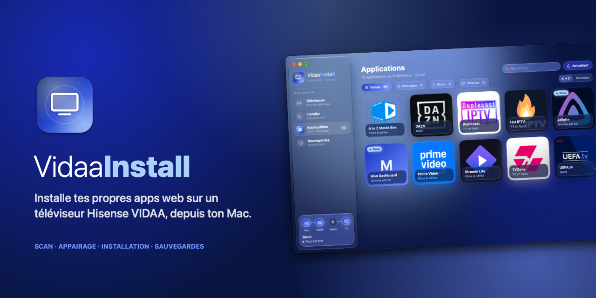
</p>

<p align="center">
  <b>Installe tes propres applications web sur un téléviseur Hisense VIDAA, depuis ton Mac.</b><br>
  <sub>App macOS native · SwiftUI · aucune dépendance · en français</sub>
</p>

<p align="center">
  <a href="https://github.com/Ampiso4/VidaaInstall/releases/latest"></a>
  
  
  <a href="LICENSE"></a>
</p>

<p align="center">
  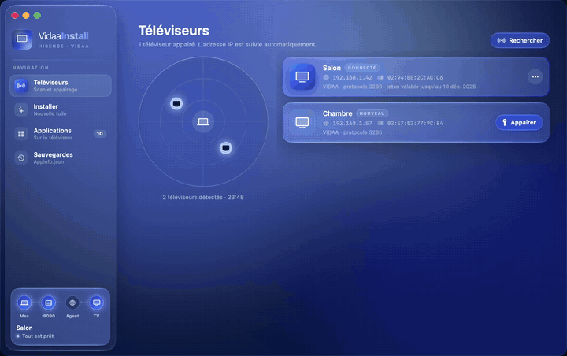
</p>

> *English summary:* **VidaaInstall** is a native macOS app that adds custom web-app tiles
> (Jellyfin, a home dashboard, any URL…) to the home screen of Hisense **VIDAA** smart TVs.
> It finds the TV on your network, pairs with a 4-digit PIN, and lets the TV's own browser
> edit its app list — with automatic backups and one-click restore. Download the DMG from
> [Releases](https://github.com/Ampiso4/VidaaInstall/releases/latest). UI in French.

---

## Sommaire

- [Ce que fait l'app](#ce-que-fait-lapp)
- [Installation](#installation)
- [Premier lancement](#premier-lancement)
- [Utilisation](#utilisation)
- [Comment ça marche](#comment-ça-marche)
- [Compiler soi-même](#compiler-soi-même)
- [FAQ](#faq)
- [Avertissement](#avertissement)

## Ce que fait l'app

| | |
|---|---|
| 📡 **Trouve les TV** | Radar de recherche (SSDP + balayage du réseau local). Le TV est reconnu par son adresse MAC : si son IP change, l'app le retrouve seule. |
| 🔐 **Appairage** | Code à 4 chiffres affiché sur le TV, jeton enregistré et renouvelé automatiquement. Plusieurs TV possibles. |
| ➕ **Installe** | Nom, URL, icône → une tuile apparaît sur l'écran d'accueil du TV, comme une vraie app. |
| 🗂 **Gère** | Grille de toutes les applications du TV, tri et filtres, modification et désinstallation. |
| 🛟 **Sauvegarde** | Copie automatique de la liste d'apps avant **chaque** modification, restauration en un clic. |

<table>
  <tr>
    <td width="50%">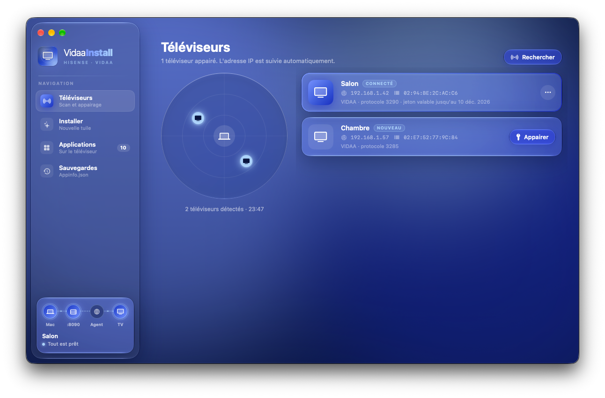<br><sub><b>Téléviseurs</b> — les TV du réseau, l'état de la liaison</sub></td>
    <td width="50%">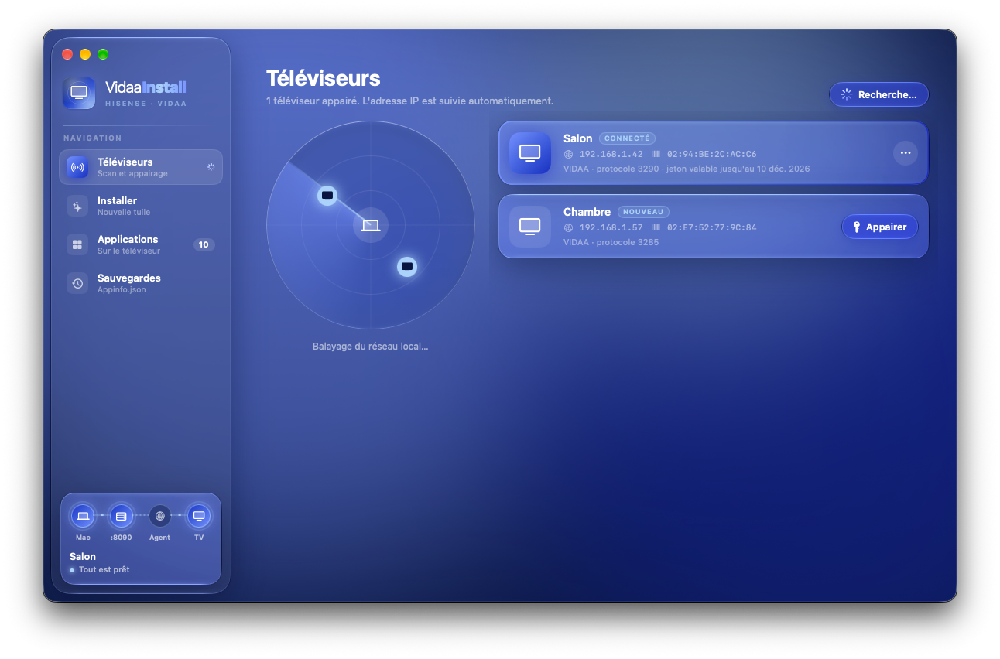<br><sub><b>Recherche</b> — le radar pendant le scan</sub></td>
  </tr>
  <tr>
    <td>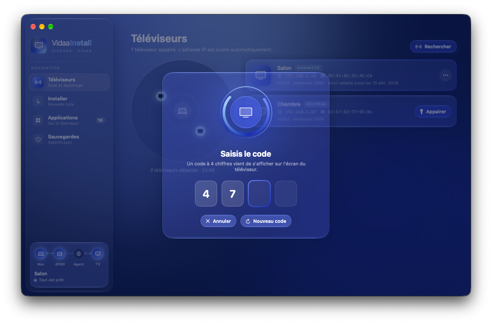<br><sub><b>Appairage</b> — le code affiché sur le TV</sub></td>
    <td>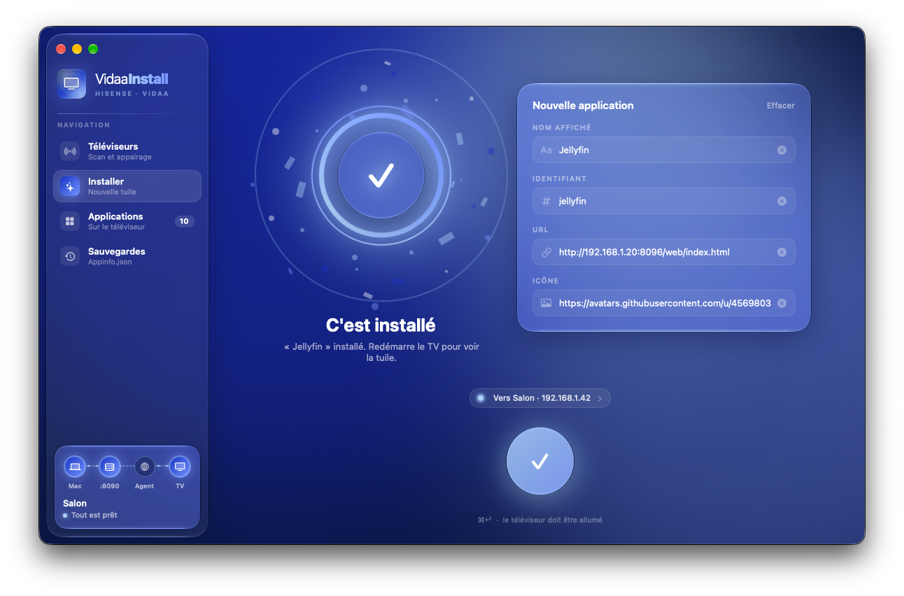<br><sub><b>Installer</b> — une app web en trois champs</sub></td>
  </tr>
  <tr>
    <td>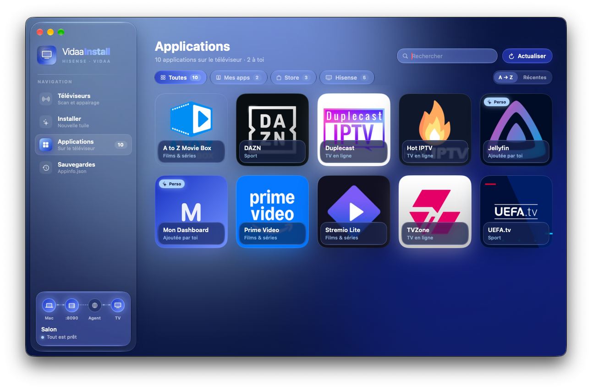<br><sub><b>Applications</b> — tout ce qui est installé sur le TV</sub></td>
    <td>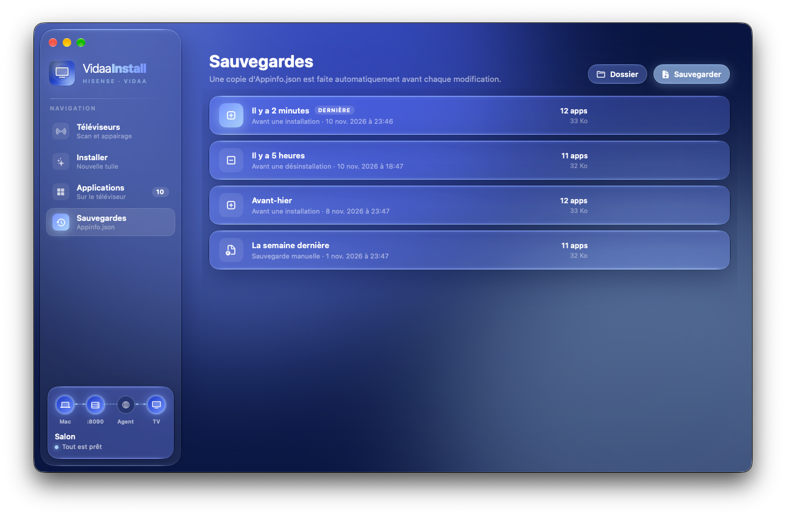<br><sub><b>Sauvegardes</b> — chaque version de la liste, restaurable</sub></td>
  </tr>
</table>

## Installation

### Option 1 — le disque (DMG)

1. Télécharge **`VidaaInstall.dmg`** depuis la [dernière release](https://github.com/Ampiso4/VidaaInstall/releases/latest).
2. Ouvre-le et glisse **VidaaInstall** sur **Applications**.
3. Lis **« À lire d'abord »** dans le disque : il explique comment autoriser l'app au premier lancement.

<p align="center">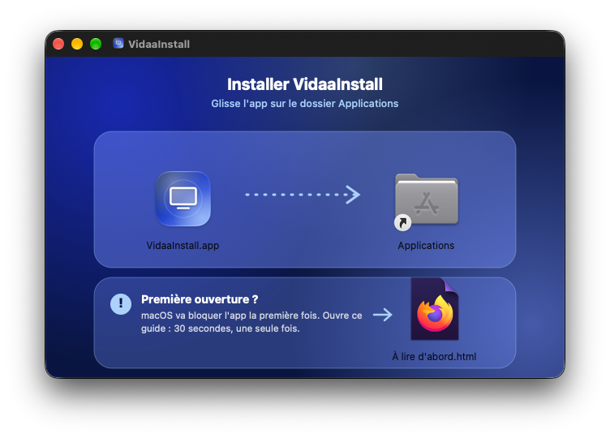</p>

### Option 2 — une ligne dans le Terminal

```bash
curl -fsSL https://raw.githubusercontent.com/Ampiso4/VidaaInstall/main/install.sh | bash
```

Le script télécharge la dernière version, la copie dans Applications et la lance. Téléchargée
par `curl`, l'app n'est pas bloquée par macOS : pas besoin de passer par les Réglages.
Relancer la même commande met l'app à jour.

**Configuration requise :** macOS 14 Sonoma ou plus récent, Mac Apple Silicon ou Intel, sur le
même réseau que le téléviseur.

## Premier lancement

L'app n'est pas signée par un développeur Apple identifié (ni notarisée). À la première
ouverture, macOS la bloque : c'est normal, et ça se règle une seule fois.

<p align="center">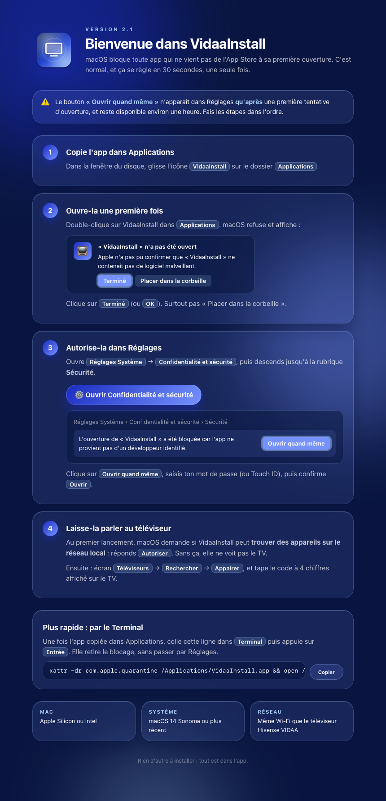</p>

1. Double-clique sur VidaaInstall → macOS refuse → clique sur **Terminé**.
2. **Réglages Système → Confidentialité et sécurité** → rubrique Sécurité → **Ouvrir quand même**.
3. Au lancement, accepte l'accès au **réseau local** (sinon l'app ne voit pas le TV).

Plus court, dans le Terminal :

```bash
xattr -dr com.apple.quarantine /Applications/VidaaInstall.app && open /Applications/VidaaInstall.app
```

Le guide complet, avec les captures, est dans [docs/INSTALLATION.md](docs/INSTALLATION.md).

## Utilisation

1. **Téléviseurs** (⌘1) → **Rechercher** (⌘K) → **Appairer** → tape le code affiché sur le TV.
2. **Installer** (⌘2) : un nom, l'URL de l'app web, une icône (URL d'image) → gros bouton rond (⌘↩).
   L'app ouvre toute seule la page « agent » sur le TV, qui exécute l'installation.

   <p align="center">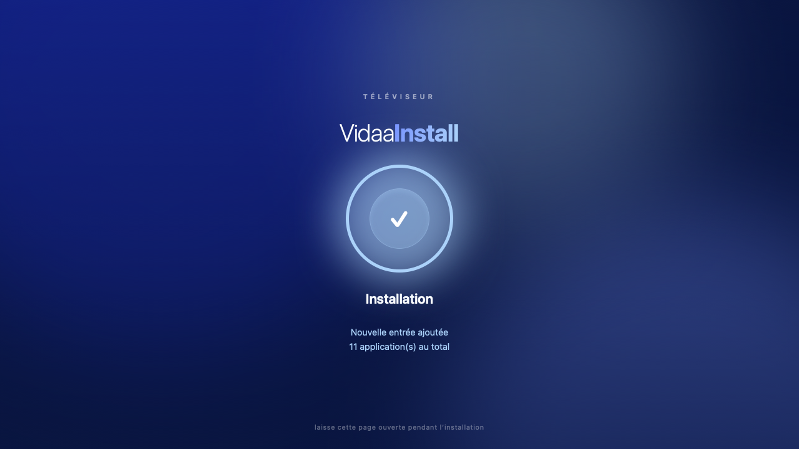</p>

3. **Applications** (⌘3) : clic droit sur une tuile pour la modifier ou la désinstaller.
4. **Sauvegardes** (⌘4) : chaque modification est précédée d'une copie ; **Restaurer** remet une version.
5. Redémarre le TV (ou rouvre l'accueil) pour voir la nouvelle tuile.

| Raccourci | Action |
|---|---|
| ⌘1 … ⌘4 | Changer d'écran |
| ⌘K | Rechercher les téléviseurs |
| ⌘R | Actualiser la liste des applications |
| ⌘S | Sauvegarder maintenant |
| ⌘↩ | Installer |

> **Garde la page agent ouverte sur le TV** pendant l'installation : c'est elle qui fait le travail.

## Comment ça marche

Le navigateur intégré des TV VIDAA expose une API, `HiUtils_createRequest`, capable de lire
et d'écrire certains fichiers système, dont **`websdk/Appinfo.json`** : la liste des
applications de l'écran d'accueil. Une « application web » n'y est qu'une entrée avec un nom,
une URL et une icône.

Cette API n'existe que dans le navigateur du TV. L'app Mac sert donc une petite page,
**l'agent**, que le TV ouvre et qui vient chercher les commandes :

```
     Mac (VidaaInstall)                                  Téléviseur VIDAA
┌──────────────────────────┐   1. « ouvre cette page »   ┌──────────────────────────┐
│ client MQTT/TLS  :36669  │ ──────────────────────────► │ lanceur d'apps            │
│                          │                             │                          │
│ serveur HTTP     :8090   │ ◄──── 2. GET /pending ───── │ agent.html (navigateur)  │
│  /agent  /pending        │                             │  HiUtils_createRequest   │
│  /result                 │ ◄──── 3. POST /result ───── │  lit / écrit Appinfo.json│
└──────────────────────────┘                             └──────────────────────────┘
```

1. Le Mac se connecte au TV en MQTT (port 36669, TLS) et lui demande d'ouvrir l'agent.
2. L'agent interroge le Mac (`/pending`) toutes les 600 ms, avec un jeton de session.
3. Il exécute la commande (lire, sauvegarder, installer, désinstaller, restaurer) et renvoie
   le résultat ainsi que **le fichier d'origine**, que le Mac archive avant toute écriture.

Détails du protocole, format des entrées et fichiers locaux : [docs/ARCHITECTURE.md](docs/ARCHITECTURE.md).

## Compiler soi-même

Seuls les outils en ligne de commande d'Apple sont nécessaires (`xcode-select --install`),
pas Xcode.

```bash
git clone https://github.com/Ampiso4/VidaaInstall.git
cd VidaaInstall
./build.sh                 # → build/VidaaInstall.app (universel) + copie dans ~/Applications
./package.sh               # → build/VidaaInstall-2.1.dmg
VERSION=2.2 ./package.sh   # autre numéro de version
tools/shots.sh             # captures d'écran de démo (données fictives) dans docs/images
tools/shots.sh --gif       # + l'animation demo.gif (ffmpeg requis)
```

`package.sh` installe [dmgbuild](https://github.com/dmgbuild/dmgbuild) dans `build/.venv`
(uniquement sur le Mac qui compile).

```
Sources/        App SwiftUI (Core : pont TV + serveur HTTP, TV : découverte, Vidaa : MQTT)
web/agent.html  Page exécutée par le navigateur du TV
tools/          Icône, bannière, fond et guide du DMG, script de captures
```

## FAQ

<details>
<summary><b>Quels téléviseurs sont compatibles ?</b></summary>

Les Hisense (et marques sœurs) sous **VIDAA OS** dont le navigateur expose
`HiUtils_createRequest`. Testé sur un VIDAA récent ; si ton modèle ne l'expose pas, la page
agent l'affiche en bas de l'écran (« HiUtils_createRequest indisponible »).
</details>

<details>
<summary><b>La tuile n'apparaît pas sur l'écran d'accueil.</b></summary>

Redémarre le téléviseur : le lanceur relit `Appinfo.json` au démarrage. Vérifie aussi, dans
**Applications**, que l'entrée est bien présente.
</details>

<details>
<summary><b>L'app ne trouve pas mon TV.</b></summary>

- Le Mac et le TV doivent être sur le même réseau (pas de Wi-Fi invité isolé).
- Autorise VidaaInstall dans **Réglages → Confidentialité et sécurité → Réseau local**.
- Le TV doit être allumé (pas en veille profonde).
</details>

<details>
<summary><b>J'ai cassé l'écran d'accueil, comment revenir en arrière ?</b></summary>

Écran **Sauvegardes** → choisis la version d'avant → **Restaurer**. Une copie est faite
automatiquement avant chaque installation, désinstallation et restauration.
</details>

<details>
<summary><b>Faut-il ré-appairer sur chaque Mac ?</b></summary>

Oui : chaque Mac tire son propre identifiant client au premier lancement, et le TV associe le
jeton à cet identifiant.
</details>

<details>
<summary><b>Où sont stockées mes données ?</b></summary>

Uniquement sur ton Mac : `~/Library/Application Support/VidaaInstall/tvs.json` (TV et jetons,
lisible par toi seul) et `~/Library/Application Support/VidaaRemote/backups/` (sauvegardes).
Rien ne sort du réseau local.
</details>

## Avertissement

Projet personnel, **non affilié à Hisense ni à VIDAA**. Les noms et marques cités appartiennent
à leurs propriétaires. L'app modifie un fichier système du téléviseur : elle en fait une copie
avant chaque écriture, mais tu l'utilises à tes risques.

## Licence

[MIT](LICENSE)
