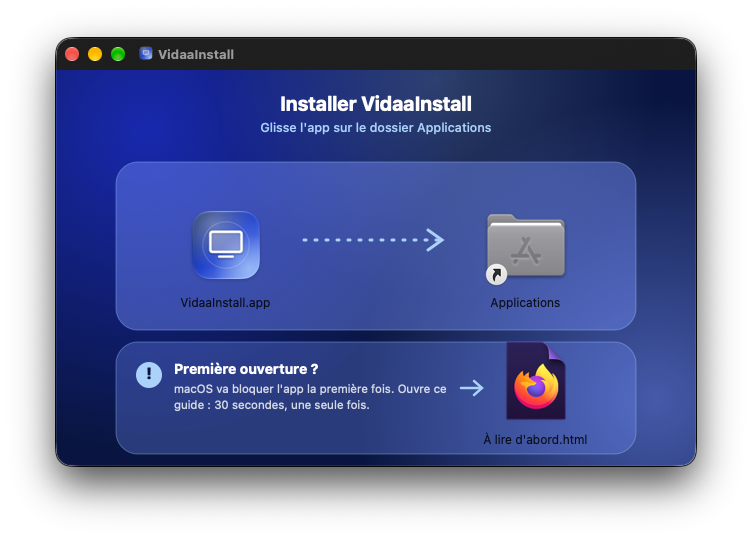
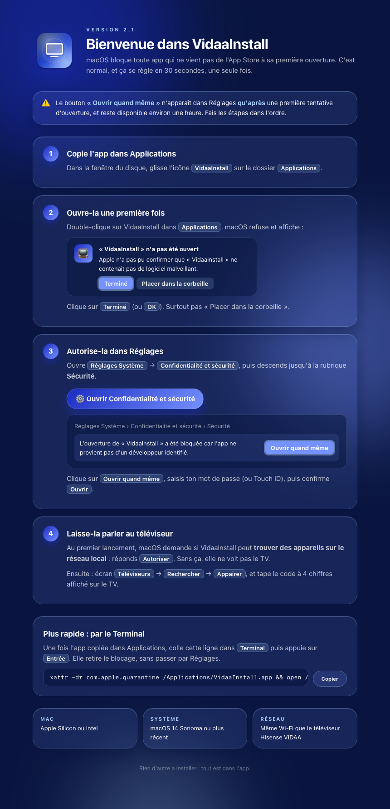
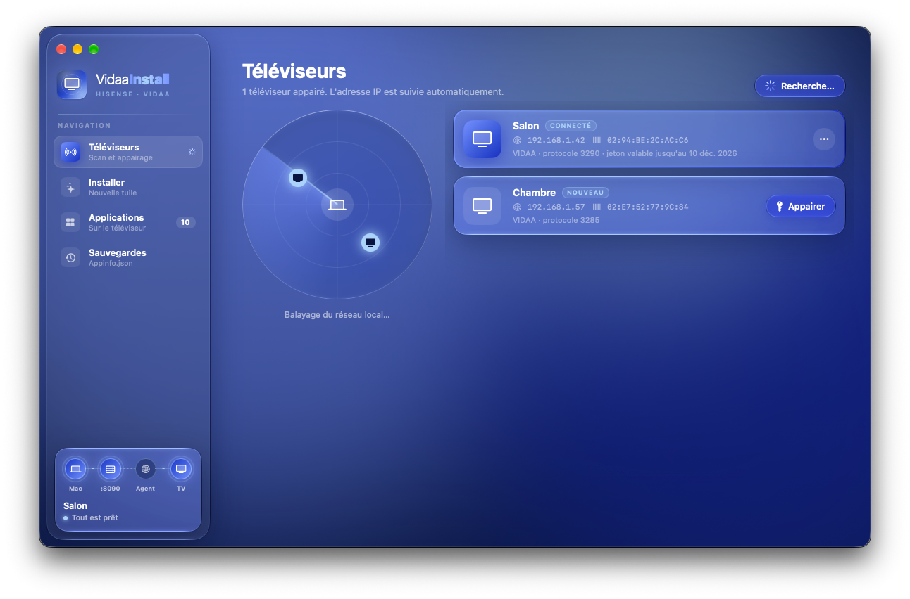
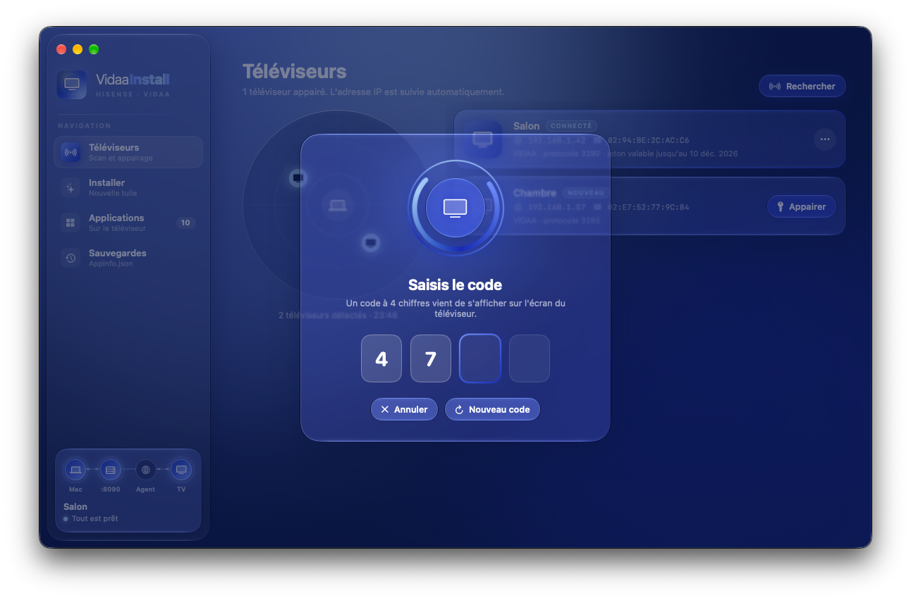
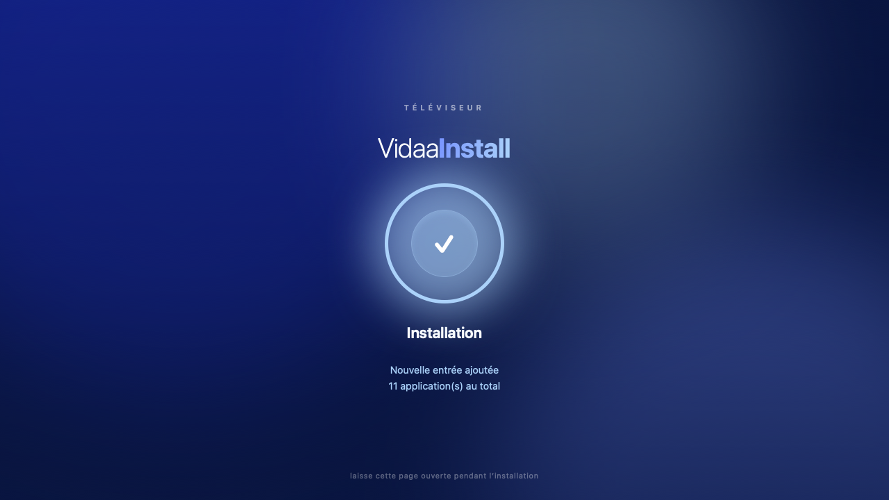

# Installer VidaaInstall

← [Retour au README](../README.md)

## 1. Télécharger

| Méthode | Commande / lien |
|---|---|
| **Disque (DMG)** | [Dernière release → `VidaaInstall.dmg`](https://github.com/Ampiso4/VidaaInstall/releases/latest) |
| **Terminal** | `curl -fsSL https://raw.githubusercontent.com/Ampiso4/VidaaInstall/main/install.sh \| bash` |

Le script Terminal fait tout le reste de ce guide à ta place (sauf l'autorisation réseau local).
Il installe dans `/Applications`, ou dans `~/Applications` si tu n'as pas les droits.

## 2. Copier l'app

Ouvre le DMG et glisse **VidaaInstall** sur le dossier **Applications**.



## 3. Passer le contrôle de macOS (une seule fois)

L'app est signée localement, pas par un développeur Apple identifié : macOS la bloque à la
première ouverture. Le disque contient **« À lire d'abord »**, qui reprend ces étapes :



1. Double-clique sur **VidaaInstall** dans Applications. macOS affiche
   « *“VidaaInstall” n'a pas été ouvert* » → clique sur **Terminé** (pas « Placer dans la corbeille »).
2. Ouvre **Réglages Système → Confidentialité et sécurité**, descends jusqu'à **Sécurité**.
3. Clique sur **Ouvrir quand même**, confirme avec ton mot de passe ou Touch ID, puis **Ouvrir**.

> Le bouton « Ouvrir quand même » n'apparaît qu'**après** une première tentative d'ouverture,
> et reste disponible environ une heure.

**Variante Terminal**, une fois l'app copiée :

```bash
xattr -dr com.apple.quarantine /Applications/VidaaInstall.app && open /Applications/VidaaInstall.app
```

## 4. Autoriser le réseau local

Au premier lancement, macOS demande si VidaaInstall peut **trouver des appareils sur le réseau
local** → **Autoriser**. Sans cette autorisation l'app ne voit pas le TV.

Si tu as refusé par erreur : **Réglages Système → Confidentialité et sécurité → Réseau local**
→ active VidaaInstall.

## 5. Appairer le téléviseur

1. Allume le TV, sur le même réseau que le Mac.
2. Écran **Téléviseurs** → **Rechercher** (⌘K). Le radar liste les TV VIDAA trouvés.

   

3. **Appairer** → un code à 4 chiffres s'affiche sur le TV → tape-le dans l'app.

   

Le jeton est enregistré et renouvelé automatiquement. Tu peux appairer plusieurs TV et choisir
la cible dans la barre latérale.

## 6. Installer une première app

Écran **Installer** : nom, URL (par ex. ton serveur Jellyfin `http://192.168.1.20:8096`),
icône (URL d'une image carrée) → gros bouton rond. Le TV ouvre la page agent et confirme :



Redémarre le TV : la tuile est sur l'écran d'accueil.

## Désinstaller VidaaInstall

```bash
rm -rf /Applications/VidaaInstall.app
rm -rf ~/Library/Application\ Support/VidaaInstall      # TV appairés et jetons
# Sauvegardes d'Appinfo.json (à garder si tu veux pouvoir restaurer) :
# ~/Library/Application Support/VidaaRemote/backups
```

Les tuiles déjà installées restent sur le TV ; supprime-les avant depuis l'écran **Applications**
si tu le souhaites.
